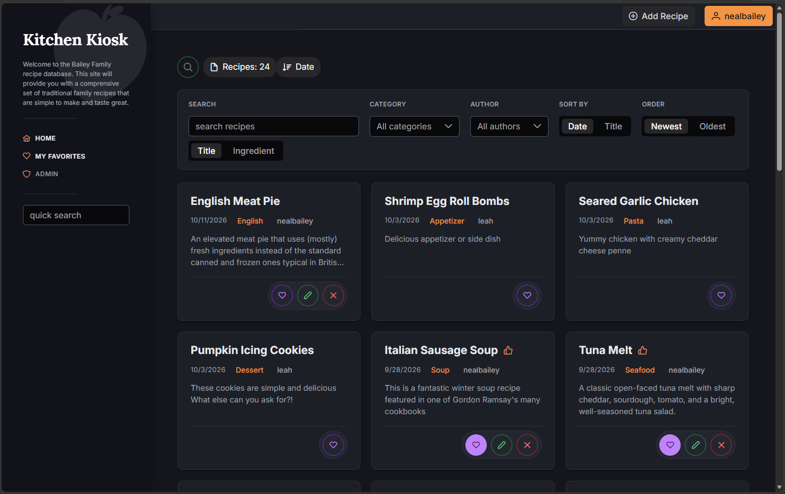

# kitchen-kiosk
Modern Next-Generation Recipe Management

[](https://dotnet.microsoft.com/)
[](https://www.mysql.com/)



Kitchen Kiosk is a single self-contained service that serves both the web app and its REST API, backed by a MySQL database. To self-host it you need:

1. A **MySQL 8** database.
2. The **Kiosk.Api** service, a single self-contained executable (the web app is built in and served from the same process, and no .NET install is needed).
3. Optionally, a reverse proxy to add HTTPS.

No Node.js, Angular, or Apache is needed to run it.

| Component | Description | Docs |
|-----------|-------------|------|
| Kiosk.Api | .NET 9 service: REST API plus the web app as static files | [Kiosk.Api/README.md](Kiosk.Api/README.md) |
| Kiosk.Web | Angular web app (prebuilt into `Kiosk.Api/wwwroot`) | [Kiosk.Web/README.md](Kiosk.Web/README.md) |

## Choose an Installation

- **Docker:** [Quickstart](quickstart.md) starts the app and MySQL together, including database setup. No .NET, Node.js, or existing MySQL installation is needed.
- **Native Linux service:** follow [Install](#install) below to manage the executable and MySQL yourself.

## Install

These steps target Ubuntu/Debian Linux with systemd. Replace the placeholders in `UPPER_CASE`.

### 1. Create the database

Run the schema script as a MySQL administrator. It creates the `KIOSK` database, all tables, the `Admin` and `User` roles, and a default administrator account.

```bash
mysql -u root -p < Database/20260807-KIOSK-SCHEMA-MYSQL.sql
```

Create a dedicated MySQL account for the service:

```sql
CREATE USER 'kiosk'@'localhost' IDENTIFIED BY 'REPLACE_WITH_MYSQL_PASSWORD';
GRANT SELECT, INSERT, UPDATE, DELETE ON KIOSK.* TO 'kiosk'@'localhost';
```

Use the MySQL server's host name instead of `localhost` if the database is on another machine.

### 2. Install the service

The service is published as a self-contained executable, so the host does **not** need .NET installed. Publish on any machine with the [.NET 9 SDK](https://dotnet.microsoft.com/download) (the host only runs the result), then copy the output to the host:

```bash
dotnet publish Kiosk.Api/Kiosk.Api.csproj -c Release -o artifacts/kiosk
sudo install -d /opt/kitchen-kiosk
sudo cp -a artifacts/kiosk/. /opt/kitchen-kiosk/
```

The output is a single `Kiosk.Api` executable (about 100 MB, linux-x64) plus `libSkiaSharp.so`, `appsettings.json`, and the `wwwroot` web app. Keep these files together in one folder. To publish for another platform, add `-r <rid>`, for example `-r linux-arm64`.

Create a service account and the settings file. The settings file holds secrets, so only root can read it:

```bash
sudo useradd --system --no-create-home --shell /usr/sbin/nologin kiosk
sudo install -d -m 700 /etc/kiosk
sudoedit /etc/kiosk/api.env
sudo chmod 600 /etc/kiosk/api.env
```

Put the following in `/etc/kiosk/api.env`:

```ini
ConnectionStrings__ConnStr='Server=MYSQL_HOST;Database=KIOSK;Uid=kiosk;Pwd=REPLACE_WITH_MYSQL_PASSWORD'
JWT__Secret='REPLACE_WITH_A_RANDOM_SIGNING_KEY_AT_LEAST_32_BYTES'
AppSettings__photosPath='/path/to/recipe/photos'
ASPNETCORE_URLS=http://127.0.0.1:5020
```

- Generate the signing key with `openssl rand -hex 32` and paste the value in.
- `photosPath` is optional. See [Photos](Kiosk.Api/README.md#photos).
- Use `KEY=value` lines without `export`. Shell expansion is not performed.
- To listen on all interfaces without a reverse proxy, use `http://0.0.0.0:5020`.

Create `/etc/systemd/system/kitchen-kiosk.service`:

```ini
[Unit]
Description=Kitchen Kiosk
Wants=network-online.target
After=network-online.target

[Service]
Type=notify
WorkingDirectory=/opt/kitchen-kiosk
ExecStart=/opt/kitchen-kiosk/Kiosk.Api
Restart=always
RestartSec=10
User=kiosk
Environment=ASPNETCORE_ENVIRONMENT=Production
EnvironmentFile=/etc/kiosk/api.env

[Install]
WantedBy=multi-user.target
```

Start it:

```bash
sudo systemctl daemon-reload
sudo systemctl enable --now kitchen-kiosk.service
sudo systemctl status kitchen-kiosk.service --no-pager
```

Browse to `http://SERVER:5020` (or `http://localhost:5020`) and continue with the [first login guide](Kiosk.Web/README.md#first-login). The default administrator is `admin` with password `ChangeMe!2026`. **Change it immediately.**

After editing `/etc/kiosk/api.env`, run `sudo systemctl restart kitchen-kiosk.service`. If the service fails to start, `sudo journalctl -u kitchen-kiosk.service -n 50` shows why. The service refuses to start if `ConnectionStrings__ConnStr` or `JWT__Secret` is missing.

### 3. HTTPS with a reverse proxy (optional)

The service speaks plain HTTP and trusts forwarded headers only from a proxy on the same machine, so keep it bound to `127.0.0.1` and let the proxy terminate TLS. Get a certificate with, for example, [Certbot](https://certbot.eff.org/).

**nginx**

```nginx
server {
    listen 443 ssl;
    server_name kiosk.example.com;
    ssl_certificate     /etc/letsencrypt/live/kiosk.example.com/fullchain.pem;
    ssl_certificate_key /etc/letsencrypt/live/kiosk.example.com/privkey.pem;

    location / {
        proxy_pass http://127.0.0.1:5020;
        proxy_set_header Host $host;
        proxy_set_header X-Forwarded-For $proxy_add_x_forwarded_for;
        proxy_set_header X-Forwarded-Proto $scheme;
    }
}
```

**Apache** (enable `proxy`, `proxy_http`, `headers`, and `ssl`)

```apache
<VirtualHost *:443>
    ServerName kiosk.example.com
    SSLEngine on
    SSLCertificateFile    /etc/letsencrypt/live/kiosk.example.com/fullchain.pem
    SSLCertificateKeyFile /etc/letsencrypt/live/kiosk.example.com/privkey.pem

    ProxyPreserveHost On
    RequestHeader set X-Forwarded-Proto "https"
    ProxyPass        / http://127.0.0.1:5020/
    ProxyPassReverse / http://127.0.0.1:5020/
</VirtualHost>
```

**Apache, under a sub-path** (for example `https://host/kiosk/` on a shared virtual host). Set `PathBase=/kiosk` in `/etc/kiosk/api.env` and restart the service, then keep the prefix when proxying:

```apache
RedirectMatch 301 ^/kiosk$ /kiosk/
ProxyPass        /kiosk/ http://127.0.0.1:5020/kiosk/
ProxyPassReverse /kiosk/ http://127.0.0.1:5020/kiosk/
```

Leave `PathBase` unset (the default) when the app is served from the root of its own host name. The web app calls the API under the same sub-path automatically.

## Update

```bash
sudo systemctl stop kitchen-kiosk.service
sudo cp -a artifacts/kiosk/. /opt/kitchen-kiosk/
sudo systemctl start kitchen-kiosk.service
```

## Development

Prerequisites: [.NET SDK 9](https://dotnet.microsoft.com/download) (see [global.json](global.json)), MySQL 8, and Node.js 22 with npm (only for changing the web app).

Run the API from the repository root with a local settings file:

```bash
cp -n dbg.env.example dbg.env && chmod 600 dbg.env   # then edit dbg.env
set -a; source ./dbg.env; set +a
dotnet run --project Kiosk.Api/Kiosk.Api.csproj --no-launch-profile
```

The API listens on http://localhost:5020 and serves Swagger at `/swagger` in Development. `*.env` files are ignored by Git. Never commit real secrets.

Web app changes:

```bash
cd Kiosk.Web
npm install
npm start               # dev server on http://localhost:4200, calls the API on port 5020
npm run build:prod      # rebuild into Kiosk.Api/wwwroot (commit the result)
```

Run the tests with `dotnet test UnitTests/UnitTests.csproj`.

### Publishing

Build the web app and the API on the development machine, then copy the result to the server. Run these from the repository root.

1. Rebuild everything and publish to `artifacts/kiosk`. The web app is built into `Kiosk.Api/wwwroot`, which the publish step bundles. The first publish downloads the runtime packs, so it needs internet access.

   ```bash
   (cd Kiosk.Web && npm ci && npm run build:prod) && dotnet publish Kiosk.Api/Kiosk.Api.csproj -c Release -o artifacts/kiosk
   ```

2. Package it and copy it to the server:

   ```bash
   tar -czf kiosk.tar.gz -C artifacts/kiosk . && scp kiosk.tar.gz USER@SERVER:/tmp/   
   ```

3. On the server, unpack it (for an update, run `sudo systemctl stop kitchen-kiosk.service` first):

   ```bash
   sudo install -d /opt/kitchen-kiosk && sudo tar -xzf /tmp/kiosk.tar.gz -C /opt/kitchen-kiosk
   sudo chmod +x /opt/kitchen-kiosk/Kiosk.Api
   ```

4. Start or restart the service: `sudo systemctl restart kitchen-kiosk.service`.

The first install also needs the database, `/etc/kiosk/api.env`, and the systemd unit described under [Install](#install).
